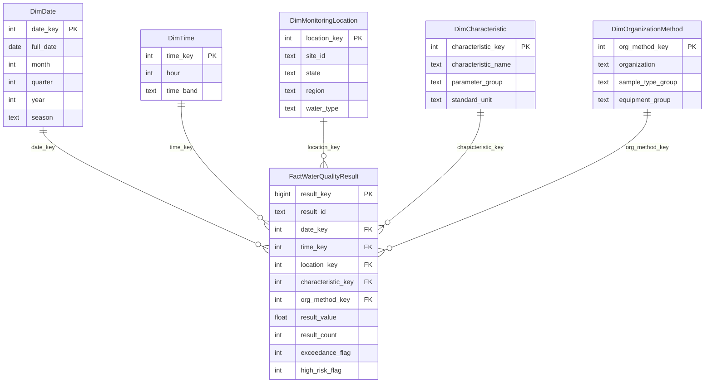
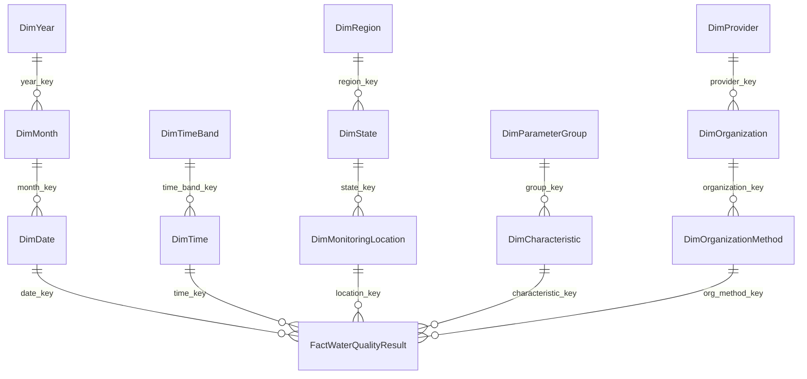
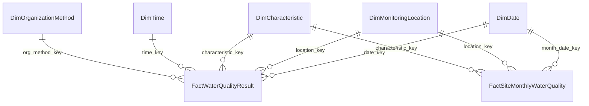

# Step 5: Dimensional Model (Star · Snowflake · Fact Constellation)

Source: `data/processed/wq_curated.parquet` (Step 2). Implemented in `05_dw_batch/`.

## 1. Grain (declared first, as the brief requires)
> **One row in `FactWaterQualityResult` = one measured characteristic result, from one monitoring location, for one sampling activity at one date/time.**

- Only **single readings** that are **analysis-ready** (Step 2) enter this fact: **3,772,033 rows**.
- **Daily summaries** (mean/min/max, 908,630 rows) are a **different grain**, so they are *not* mixed into this fact (Step 1 finding P6b).
- The second fact (`FactSiteMonthlyWaterQuality`) has its own, coarser grain: **site × characteristic × month**.

## 2. Dimensions (size measured on the analysis-ready data)
| Dimension | Key | Attributes | Rows | Hierarchy |
|---|---|---|---|---|
| **DimDate** | `date_key` (YYYYMMDD) | full_date, day, day_name, is_weekend, week, month, month_name, quarter, year, season | 731 (2024–2025, every day) | Year → Quarter → Month → Day |
| **DimTime** | `time_key` (hour 0–23; −1 = Not Reported) | hour, time_band | 25 | TimeBand → Hour |
| **DimMonitoringLocation** | `location_key` (surrogate) | site_id, state, region, latitude, longitude, water_type (location-type proxy), state_match | 49,271 sites | Region → State → Site |
| **DimCharacteristic** | `characteristic_key` | characteristic_name, short_name, parameter_group, standard_unit, exceedance rule, high-risk rule, threshold source | 6 | ParameterGroup → Characteristic |
| **DimOrganizationMethod** | `org_method_key` | organization, provider, sample_type_group, equipment_group, result_status, value_type | 928 combinations | Provider → Organization |

`DimOrganizationMethod` is a **junk (combined) dimension**: several small descriptive fields that would otherwise be separate tiny dimensions are combined into one table of their 928 real combinations.

**Role-playing dimension:** `DimDate` is the conformed date for both facts. The monthly fact uses the date of the **first day of the month** (`month_date_key`), so the same `DimDate` table serves both without duplicating calendar data.

## 3. Facts
### FactWaterQualityResult (transaction grain)
| Column | Type | Meaning |
|---|---|---|
| `result_key` | surrogate (BIGSERIAL) | warehouse row ID |
| `result_id` | degenerate dimension | original WQP `ResultIdentifier` (traceability) |
| `date_key`, `time_key`, `location_key`, `characteristic_key`, `org_method_key` | FK | links to the 5 dimensions |
| `result_value` | measure | value in standard unit |
| `result_count` | measure | always 1 (additive: SUM = number of results) |
| `exceedance_flag`, `high_risk_flag` | measure (0/1) | SUM = count, AVG = rate |
| `result_band` | attribute | Very Low … Very High |
| `is_extreme_outlier`, `is_provisional` | flags | quality flags kept for filtering |
| `load_batch_id` | audit | which ETL load inserted the row |

### FactSiteMonthlyWaterQuality (periodic snapshot / aggregate grain)
| Column | Meaning |
|---|---|
| `location_key`, `characteristic_key`, `month_date_key` | grain: site × characteristic × month (≈ 996K rows) |
| `sample_count` | number of results |
| `average_result`, `maximum_result`, `minimum_result`, `median_result` | value summaries |
| `exceedance_count`, `high_risk_count` | outcome counts |

It is **built from `FactWaterQualityResult`** inside the warehouse, so both facts always agree.

## 4. Star schema

## 5. Snowflake schema (normalised hierarchies)

Each repeated text value (region name, state name, month name, parameter group, organization) moves into its own small table, referenced by a key.

## 6. Fact constellation (two facts sharing conformed dimensions)

## 7. Comparison of the three models
| Criterion | Star | Snowflake | Fact constellation (star dims + 2 facts) |
|---|---|---|---|
| Number of tables | 6 (1 fact + 5 dims) | 13 (1 fact + 12 dims) | 7 (2 facts + 5 shared dims) |
| Joins for "exceedance rate by region and month" | 2 (fact→location, fact→date) | 5 (fact→location→state→region, fact→date→month) | 2 on the detail fact; **0–2 on the monthly fact** |
| Storage redundancy | Some: region/state names repeated across 49K site rows (≈ 1–2 MB) | Lowest | Same as star, plus a ~996K-row aggregate (≈ 4× smaller than the detail fact) |
| Query complexity | Low | High (long join chains) | Low; trend queries are simpler on the monthly fact |
| BI / dashboard simplicity (Power BI) | Very good (Power BI's recommended shape) | Poorer (more relationships, slower model) | Very good |
| Maintainability | Good | Good for hierarchies, but more ETL steps | Good; the aggregate is rebuilt from the detail fact |
| Performance | Good | Slower (extra joins) | **Best for monthly/site queries** (pre-aggregated) |
| Hierarchy management | Hierarchies as columns (Region → State → Site) | Explicit tables per level | Same as star |
| Fits brief questions | Q1–Q8 | Q1–Q8 | Q1–Q8, plus fast trend/coverage (Q1, Q4, Q7) on the monthly fact |

## 8. Selected model and justification
**Selected: Fact constellation with star-shaped (denormalised) conformed dimensions.**
1. **The data has two natural grains**: individual results (for exceedance detail, mining and drill-through) and site-month summaries (for trends, coverage and the dashboard). One fact per grain avoids mixing grains.
2. **Star-shaped dimensions** keep joins short. The hierarchies (Region → State → Site, Year → Quarter → Month → Day, Group → Characteristic) are stored as columns, which Power BI and OLAP CUBE/ROLLUP use directly.
3. **The redundancy cost is tiny**: the dimensions are small (largest 49K rows), while the fact holds 3.77M rows, so normalising (snowflake) would save only kilobytes but add 3+ joins to every query.
4. **Shared (conformed) dimensions** mean the detail and monthly facts always slice the same way, so numbers agree across reports.

The snowflake design is documented above for comparison; the **implementation** (`05_dw_batch/sql/01_create_schema.sql`) builds the selected constellation.
