# OLAP Operations (Step 9, brief §13)

All queries run on the **batch warehouse** (PostgreSQL, schema `dw`). The SQL lives in `sql/01_olap_operations.sql`; `olap_runner.py` runs each query 3 times, keeps the median time, and saves the result to `tables/<id>.csv` and a chart to `figures/<id>.png`. Timings for all queries: `tables/O00_query_times.csv`.

## Hierarchies and measures used

| Hierarchy | Levels (top → bottom) | Table |
|---|---|---|
| Time | Year → Quarter → Month → Day (+ Season) | `dw.dim_date` |
| Geography | Region → State → Site | `dw.dim_monitoring_location` |
| Parameter | Parameter group → Characteristic | `dw.dim_characteristic` |

| Measure | How it is computed | Note |
|---|---|---|
| Results | `count(*)` on the detail fact, `sum(sample_count)` on the monthly fact | additive |
| Sites | `count(DISTINCT location_key)` | not additive (a site can appear in many groups) |
| Exceedance rate % | `100 × avg(exceedance_flag)` = exceedances ÷ results | `exceedance_flag` is a **derived** field (project / EPA thresholds applied in the ETL), not a WQP source field |
| High-risk rate % | `100 × avg(high_risk_flag)` | **derived** in the same way, stricter thresholds |
| Median value | `percentile_cont(0.5)` | only within **one** characteristic (units differ), and only on the detail fact (medians cannot be added up) |

**Which fact table?** Queries that need only counts and rates read the small monthly fact `fact_site_monthly_water_quality` (rates are rebuilt as `sum(exceedance_count) / sum(sample_count)`, which is exact). Queries that need a median read the detail fact `fact_water_quality_result`. This is the *fact constellation* design from Step 5 being used as intended.

## Coverage checklist

| Operation | Queries |
|---|---|
| Roll-Up (consolidation) | `O01_rollup_geography`, `O02_rollup_time` |
| Drill-Down | `O03_drilldown_time`, `O04_drilldown_geography` |
| Slice | `O05_slice_parameter`, `O06_slice_time` |
| Dice | `O07_dice_region_season`, `O08_dice_physical_surface` |
| Pivot (rotate) | `O09_pivot_parameter_season`, `O10_pivot_region_parameter` |
| CUBE | `O11_cube_month_region_group`, `O12_cube_season_group` |
| GROUPING SETS | `O13_grouping_sets_summary`, `O14_grouping_sets_org_method` |
| ROLLUP | `O15_rollup_time_hierarchy`, `O16_rollup_parameter_hierarchy` |

---

## Roll-Up (consolidation)

**In simple words:** Climbing **up** a hierarchy: many detailed numbers are added together into fewer, bigger totals (Site → State → Region, or Month → Quarter → Year). You lose detail but see the big picture.

**Analogy:** Like going from your daily expenses to your monthly bill, then to your yearly total.

**Same thing in Power BI:** Matrix visual with the hierarchy on rows, collapsed to the top level (or the "Drill up" arrow).

### O01_rollup_geography

- **Business question:** Which regions have the highest exceedance rate when site-level results are rolled up to region level?
- **Dimensions:** Geography (Site → State → **Region**)
- **Measure:** sites, results, exceedances, exceedance %, high-risk %
- **OLAP operation:** Roll-Up (consolidation)
- **SQL:**

```sql
-- Site -> State -> Region: the detail rows are summarised up to the top level of the Geography hierarchy.
SELECT l.region,
       count(DISTINCT l.state)                         AS states,
       count(DISTINCT m.location_key)                  AS sites,
       sum(m.sample_count)                             AS results,
       sum(m.exceedance_count)                         AS exceedances,
       round(100.0 * sum(m.exceedance_count) / sum(m.sample_count), 2) AS exceedance_pct,
       round(100.0 * sum(m.high_risk_count)  / sum(m.sample_count), 2) AS high_risk_pct
FROM dw.fact_site_monthly_water_quality m
JOIN dw.dim_monitoring_location l USING (location_key)
GROUP BY l.region
ORDER BY exceedance_pct DESC;
```

- **Output:** `tables/O01_rollup_geography.csv`, chart `figures/O01_rollup_geography.png`. Rows: _[TO FILL after local run]_. Median time: _[TO FILL from tables/O00_query_times.csv]_ ms.

  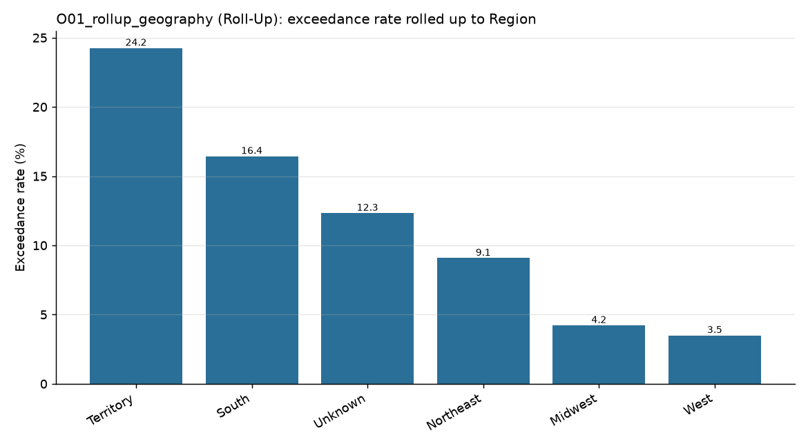

- **Interpretation:** _[TO FILL after local run: 2–3 sentences. What is the largest / smallest value, how big is the gap, and what does it mean for monitoring?]_

### O02_rollup_time

- **Business question:** How does the exceedance rate change when monthly results are rolled up to quarters and years?
- **Dimensions:** Time (Month → **Quarter → Year**)
- **Measure:** results, sites, exceedance %, high-risk %
- **OLAP operation:** Roll-Up (consolidation)
- **SQL:**

```sql
-- Month -> Quarter -> Year: the monthly snapshot is summarised to Year x Quarter.
SELECT d.year,
       'Q' || d.quarter                                AS quarter,
       d.year || '-Q' || d.quarter                     AS year_quarter,
       sum(m.sample_count)                             AS results,
       count(DISTINCT m.location_key)                  AS sites,
       round(100.0 * sum(m.exceedance_count) / sum(m.sample_count), 2) AS exceedance_pct,
       round(100.0 * sum(m.high_risk_count)  / sum(m.sample_count), 2) AS high_risk_pct
FROM dw.fact_site_monthly_water_quality m
JOIN dw.dim_date d ON d.date_key = m.month_date_key
GROUP BY d.year, d.quarter
ORDER BY d.year, d.quarter;
```

- **Output:** `tables/O02_rollup_time.csv`, chart `figures/O02_rollup_time.png`. Rows: _[TO FILL after local run]_. Median time: _[TO FILL from tables/O00_query_times.csv]_ ms.

  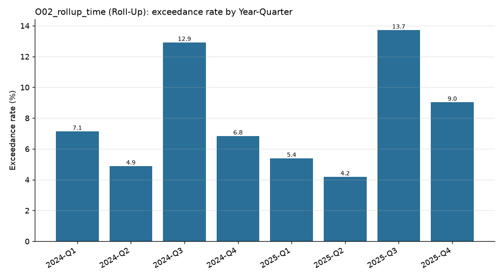

- **Interpretation:** _[TO FILL after local run: 2–3 sentences. What is the largest / smallest value, how big is the gap, and what does it mean for monitoring?]_

---

## Drill-Down

**In simple words:** The opposite of roll-up: going **down** a hierarchy to see the detail behind a total (Year → Quarter → Month, or Region → State → Site).

**Analogy:** Your yearly bill looks high, so you open the monthly statements, then the individual receipts.

**Same thing in Power BI:** Any visual with a hierarchy on the axis: turn on "Drill down" (the single down-arrow) and click a bar.

### O03_drilldown_time

- **Business question:** Within each year and quarter, which months drive the dissolved-oxygen exceedances?
- **Dimensions:** Time (Year → Quarter → **Month**), Parameter fixed to Dissolved oxygen
- **Measure:** results, exceedance %, high-risk %, median DO (mg/L)
- **OLAP operation:** Drill-Down
- **SQL:**

```sql
-- Year -> Quarter -> Month for one parameter (DO), using the detail fact so the median is exact.
SELECT d.year, d.quarter, d.month, d.year_month, d.month_name,
       count(*)                                        AS results,
       round(100.0 * avg(f.exceedance_flag), 2)        AS exceedance_pct,
       round(100.0 * avg(f.high_risk_flag), 2)         AS high_risk_pct,
       round(percentile_cont(0.5) WITHIN GROUP (ORDER BY f.result_value)::numeric, 2) AS median_value
FROM dw.fact_water_quality_result f
JOIN dw.dim_date d USING (date_key)
JOIN dw.dim_characteristic c USING (characteristic_key)
WHERE c.short_name = 'Dissolved oxygen'
GROUP BY d.year, d.quarter, d.month, d.year_month, d.month_name
ORDER BY d.year, d.quarter, d.month;
```

- **Output:** `tables/O03_drilldown_time.csv`, chart `figures/O03_drilldown_time.png`. Rows: _[TO FILL after local run]_. Median time: _[TO FILL from tables/O00_query_times.csv]_ ms.

  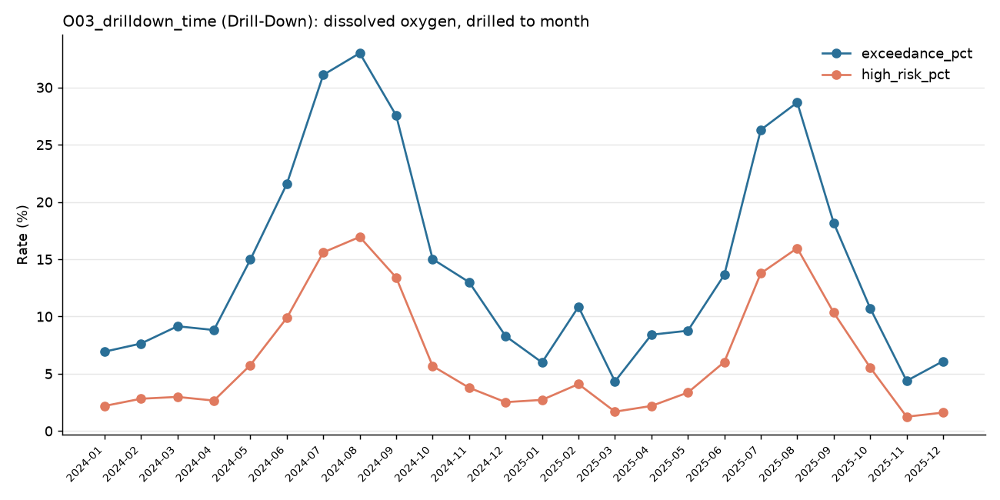

- **Interpretation:** _[TO FILL after local run: 2–3 sentences. What is the largest / smallest value, how big is the gap, and what does it mean for monitoring?]_

### O04_drilldown_geography

- **Business question:** Inside the worst state, which individual sites cause most exceedances?
- **Dimensions:** Geography (Region → State → **Site**) for the worst state (≥ 10,000 results), sites with ≥ 30 results
- **Measure:** results, exceedances, exceedance %, high-risk %
- **OLAP operation:** Drill-Down
- **SQL:**

```sql
-- Region -> State -> Site: first find the state with the highest exceedance rate (at least 10000 results),
-- then drill down to its sites with at least 30 results.
WITH state_rate AS (
    SELECT l.region, l.state, sum(m.sample_count) AS results,
           sum(m.exceedance_count)::numeric / sum(m.sample_count) AS rate
    FROM dw.fact_site_monthly_water_quality m
    JOIN dw.dim_monitoring_location l USING (location_key)
    WHERE l.state IS NOT NULL
    GROUP BY l.region, l.state
    HAVING sum(m.sample_count) >= 10000
), worst AS (
    SELECT region, state FROM state_rate ORDER BY rate DESC LIMIT 1
)
SELECT l.region, l.state, l.site_id, l.water_type,
       sum(m.sample_count)                             AS results,
       sum(m.exceedance_count)                         AS exceedances,
       round(100.0 * sum(m.exceedance_count) / sum(m.sample_count), 2) AS exceedance_pct,
       round(100.0 * sum(m.high_risk_count)  / sum(m.sample_count), 2) AS high_risk_pct
FROM dw.fact_site_monthly_water_quality m
JOIN dw.dim_monitoring_location l USING (location_key)
JOIN worst w ON w.region = l.region AND w.state = l.state
GROUP BY l.region, l.state, l.site_id, l.water_type
HAVING sum(m.sample_count) >= 30
ORDER BY exceedances DESC, exceedance_pct DESC
LIMIT 15;
```

- **Output:** `tables/O04_drilldown_geography.csv`, chart `figures/O04_drilldown_geography.png`. Rows: _[TO FILL after local run]_. Median time: _[TO FILL from tables/O00_query_times.csv]_ ms.

  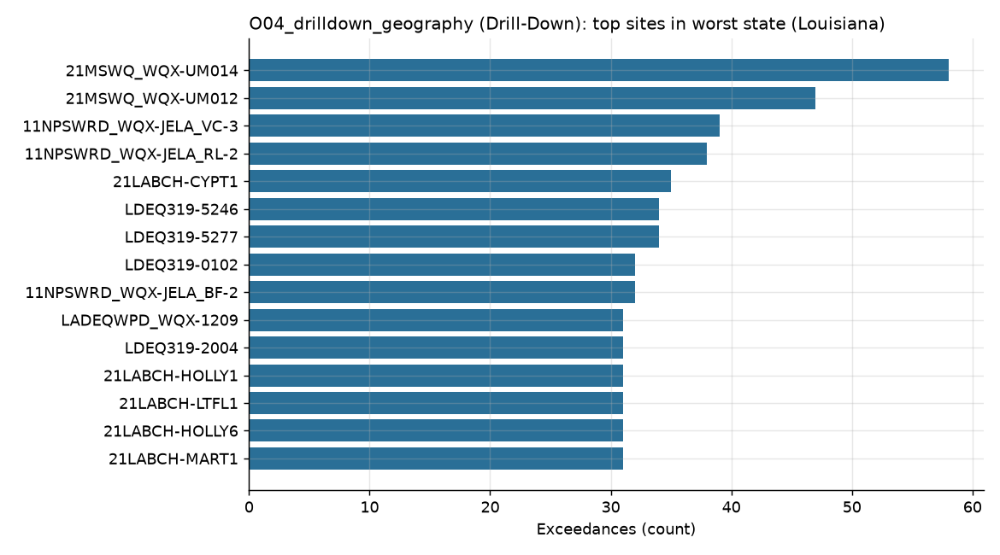

- **Interpretation:** _[TO FILL after local run: 2–3 sentences. What is the largest / smallest value, how big is the gap, and what does it mean for monitoring?]_

---

## Slice

**In simple words:** Fixing **one** dimension to a **single** value and looking at what is left. The cube is "cut" by one plane.

**Analogy:** Taking one slice out of a loaf of bread: you look only at that slice.

**Same thing in Power BI:** A slicer with a single selection (e.g. Parameter = Dissolved oxygen).

### O05_slice_parameter

- **Business question:** For dissolved oxygen only, how does the exceedance rate vary by region and season?
- **Dimensions:** Region × Season (slice: Characteristic = Dissolved oxygen)
- **Measure:** results, exceedance %, high-risk %, median DO
- **OLAP operation:** Slice
- **SQL:**

```sql
-- Slice: one dimension is fixed to a single value (Characteristic = Dissolved oxygen), leaving a Region x Season sub-cube.
SELECT l.region, d.season,
       count(*)                                        AS results,
       round(100.0 * avg(f.exceedance_flag), 2)        AS exceedance_pct,
       round(100.0 * avg(f.high_risk_flag), 2)         AS high_risk_pct,
       round(percentile_cont(0.5) WITHIN GROUP (ORDER BY f.result_value)::numeric, 2) AS median_value
FROM dw.fact_water_quality_result f
JOIN dw.dim_date d USING (date_key)
JOIN dw.dim_monitoring_location l USING (location_key)
JOIN dw.dim_characteristic c USING (characteristic_key)
WHERE c.short_name = 'Dissolved oxygen'
GROUP BY l.region, d.season
ORDER BY l.region, d.season;
```

- **Output:** `tables/O05_slice_parameter.csv`, chart `figures/O05_slice_parameter.png`. Rows: _[TO FILL after local run]_. Median time: _[TO FILL from tables/O00_query_times.csv]_ ms.

  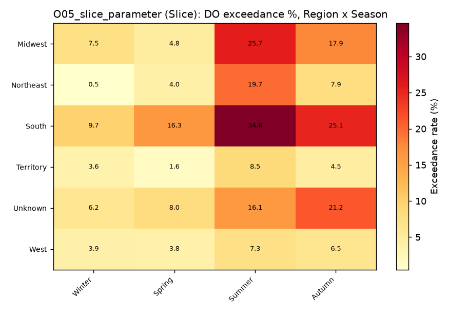

- **Interpretation:** _[TO FILL after local run: 2–3 sentences. What is the largest / smallest value, how big is the gap, and what does it mean for monitoring?]_

### O06_slice_time

- **Business question:** In the year 2025 only, which parameters exceed their thresholds most often?
- **Dimensions:** Parameter (slice: Year = 2025)
- **Measure:** results, sites, exceedance %, high-risk %, median value
- **OLAP operation:** Slice
- **SQL:**

```sql
-- Slice: Time is fixed to Year = 2025, leaving the Parameter dimension.
SELECT c.parameter_group, c.short_name, c.standard_unit,
       count(*)                                        AS results,
       count(DISTINCT f.location_key)                  AS sites,
       round(100.0 * avg(f.exceedance_flag), 2)        AS exceedance_pct,
       round(100.0 * avg(f.high_risk_flag), 2)         AS high_risk_pct,
       round(percentile_cont(0.5) WITHIN GROUP (ORDER BY f.result_value)::numeric, 2) AS median_value
FROM dw.fact_water_quality_result f
JOIN dw.dim_date d USING (date_key)
JOIN dw.dim_characteristic c USING (characteristic_key)
WHERE d.year = 2025
GROUP BY c.parameter_group, c.short_name, c.standard_unit
ORDER BY exceedance_pct DESC;
```

- **Output:** `tables/O06_slice_time.csv`, chart `figures/O06_slice_time.png`. Rows: _[TO FILL after local run]_. Median time: _[TO FILL from tables/O00_query_times.csv]_ ms.

  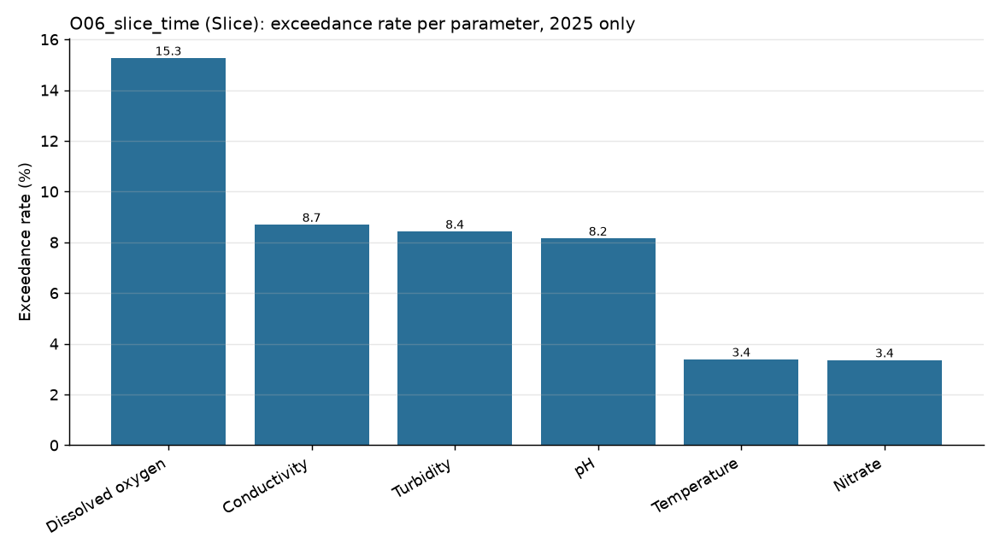

- **Interpretation:** _[TO FILL after local run: 2–3 sentences. What is the largest / smallest value, how big is the gap, and what does it mean for monitoring?]_

---

## Dice

**In simple words:** Filtering **several** dimensions at once, each to one or more values. The result is a smaller sub-cube.

**Analogy:** Cutting a cake into a small cube: limited in width, depth and height at the same time.

**Same thing in Power BI:** Several slicers used together (Region, Season, Parameter group).

### O07_dice_region_season

- **Business question:** In the South and West, for Chemical parameters, how different are summer and winter exceedance rates?
- **Dimensions:** Region ∈ {South, West} × Season ∈ {Summer, Winter} × Characteristic (Parameter group = Chemical)
- **Measure:** results, exceedance %, high-risk %, median value
- **OLAP operation:** Dice
- **SQL:**

```sql
-- Dice: several dimensions are filtered at once (Region in South/West, Season in Summer/Winter, ParameterGroup = Chemical).
SELECT l.region, d.season, c.short_name,
       count(*)                                        AS results,
       round(100.0 * avg(f.exceedance_flag), 2)        AS exceedance_pct,
       round(100.0 * avg(f.high_risk_flag), 2)         AS high_risk_pct,
       round(percentile_cont(0.5) WITHIN GROUP (ORDER BY f.result_value)::numeric, 2) AS median_value
FROM dw.fact_water_quality_result f
JOIN dw.dim_date d USING (date_key)
JOIN dw.dim_monitoring_location l USING (location_key)
JOIN dw.dim_characteristic c USING (characteristic_key)
WHERE l.region IN ('South', 'West')
  AND d.season IN ('Summer', 'Winter')
  AND c.parameter_group = 'Chemical'
GROUP BY l.region, d.season, c.short_name
ORDER BY c.short_name, l.region, d.season;
```

- **Output:** `tables/O07_dice_region_season.csv`, chart `figures/O07_dice_region_season.png`. Rows: _[TO FILL after local run]_. Median time: _[TO FILL from tables/O00_query_times.csv]_ ms.

  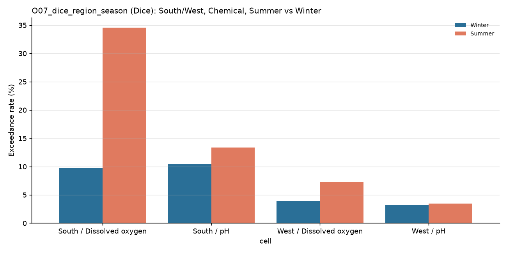

- **Interpretation:** _[TO FILL after local run: 2–3 sentences. What is the largest / smallest value, how big is the gap, and what does it mean for monitoring?]_

### O08_dice_physical_surface

- **Business question:** For Physical parameters at surface-water sites during summer 2025, which states have the highest exceedance rate?
- **Dimensions:** State (dice: Physical parameters, Surface Water, 2025, Summer, ≥ 500 results)
- **Measure:** results, sites, exceedance %, high-risk %
- **OLAP operation:** Dice
- **SQL:**

```sql
-- Dice: ParameterGroup = Physical, water_type = Surface Water, Year = 2025, Season = Summer, states with at least 500 results.
SELECT l.region, l.state,
       count(*)                                        AS results,
       count(DISTINCT f.location_key)                  AS sites,
       round(100.0 * avg(f.exceedance_flag), 2)        AS exceedance_pct,
       round(100.0 * avg(f.high_risk_flag), 2)         AS high_risk_pct
FROM dw.fact_water_quality_result f
JOIN dw.dim_date d USING (date_key)
JOIN dw.dim_monitoring_location l USING (location_key)
JOIN dw.dim_characteristic c USING (characteristic_key)
WHERE c.parameter_group = 'Physical'
  AND l.water_type = 'Surface Water'
  AND d.year = 2025
  AND d.season = 'Summer'
GROUP BY l.region, l.state
HAVING count(*) >= 500
ORDER BY exceedance_pct DESC
LIMIT 20;
```

- **Output:** `tables/O08_dice_physical_surface.csv`, chart `figures/O08_dice_physical_surface.png`. Rows: _[TO FILL after local run]_. Median time: _[TO FILL from tables/O00_query_times.csv]_ ms.

  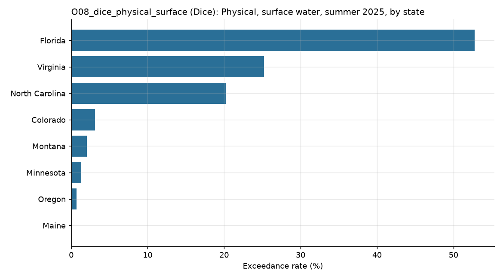

- **Interpretation:** _[TO FILL after local run: 2–3 sentences. What is the largest / smallest value, how big is the gap, and what does it mean for monitoring?]_

---

## Pivot (rotate)

**In simple words:** Turning the table: a dimension that was in the rows is moved to the columns, so the same numbers are shown as a grid that is easier to compare.

**Analogy:** Turning a spreadsheet sideways so the months run across the top instead of down the side.

**Same thing in Power BI:** Matrix visual: drag the field from Rows to Columns.

### O09_pivot_parameter_season

- **Business question:** Shown as a parameter-by-season grid, which parameter is most seasonal?
- **Dimensions:** Characteristic (rows) × Season (columns)
- **Measure:** exceedance % per season, overall %, seasonal range (percentage points)
- **OLAP operation:** Pivot (rotate)
- **SQL:**

```sql
-- Pivot (rotate): seasons move from rows to columns using conditional aggregation (FILTER).
-- seasonal_range_pts = highest season rate minus lowest season rate (percentage points).
SELECT short_name, winter_pct, spring_pct, summer_pct, autumn_pct, all_seasons_pct,
       greatest(winter_pct, spring_pct, summer_pct, autumn_pct)
         - least(winter_pct, spring_pct, summer_pct, autumn_pct)                  AS seasonal_range_pts
FROM (SELECT c.short_name,
             round(100.0 * avg(f.exceedance_flag) FILTER (WHERE d.season = 'Winter'), 2) AS winter_pct,
             round(100.0 * avg(f.exceedance_flag) FILTER (WHERE d.season = 'Spring'), 2) AS spring_pct,
             round(100.0 * avg(f.exceedance_flag) FILTER (WHERE d.season = 'Summer'), 2) AS summer_pct,
             round(100.0 * avg(f.exceedance_flag) FILTER (WHERE d.season = 'Autumn'), 2) AS autumn_pct,
             round(100.0 * avg(f.exceedance_flag), 2)                                    AS all_seasons_pct
      FROM dw.fact_water_quality_result f
      JOIN dw.dim_date d USING (date_key)
      JOIN dw.dim_characteristic c USING (characteristic_key)
      GROUP BY c.short_name) p
ORDER BY seasonal_range_pts DESC;
```

- **Output:** `tables/O09_pivot_parameter_season.csv`, chart `figures/O09_pivot_parameter_season.png`. Rows: _[TO FILL after local run]_. Median time: _[TO FILL from tables/O00_query_times.csv]_ ms.

  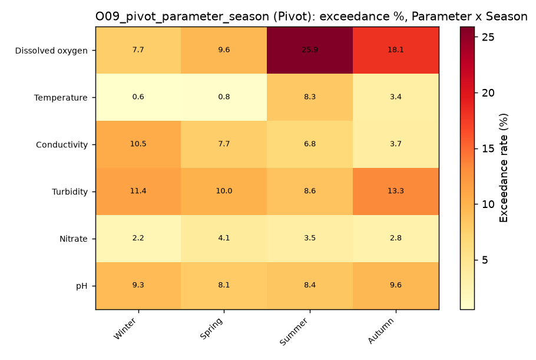

- **Interpretation:** _[TO FILL after local run: 2–3 sentences. What is the largest / smallest value, how big is the gap, and what does it mean for monitoring?]_

### O10_pivot_region_parameter

- **Business question:** Shown as a region-by-parameter grid, where is each parameter worst?
- **Dimensions:** Region (rows) × Characteristic (columns)
- **Measure:** exceedance % per parameter, all-parameter %
- **OLAP operation:** Pivot (rotate)
- **SQL:**

```sql
-- Pivot: parameters become columns (exceedance %), regions are rows. Read from the aggregate fact.
SELECT l.region,
       round(100.0 * sum(m.exceedance_count) FILTER (WHERE c.short_name = 'Dissolved oxygen') / nullif(sum(m.sample_count) FILTER (WHERE c.short_name = 'Dissolved oxygen'), 0), 2) AS dissolved_oxygen_pct,
       round(100.0 * sum(m.exceedance_count) FILTER (WHERE c.short_name = 'Turbidity')        / nullif(sum(m.sample_count) FILTER (WHERE c.short_name = 'Turbidity'), 0), 2)        AS turbidity_pct,
       round(100.0 * sum(m.exceedance_count) FILTER (WHERE c.short_name = 'pH')               / nullif(sum(m.sample_count) FILTER (WHERE c.short_name = 'pH'), 0), 2)               AS ph_pct,
       round(100.0 * sum(m.exceedance_count) FILTER (WHERE c.short_name = 'Conductivity')     / nullif(sum(m.sample_count) FILTER (WHERE c.short_name = 'Conductivity'), 0), 2)     AS conductivity_pct,
       round(100.0 * sum(m.exceedance_count) FILTER (WHERE c.short_name = 'Temperature')      / nullif(sum(m.sample_count) FILTER (WHERE c.short_name = 'Temperature'), 0), 2)      AS temperature_pct,
       round(100.0 * sum(m.exceedance_count) FILTER (WHERE c.short_name = 'Nitrate')          / nullif(sum(m.sample_count) FILTER (WHERE c.short_name = 'Nitrate'), 0), 2)          AS nitrate_pct,
       round(100.0 * sum(m.exceedance_count) / sum(m.sample_count), 2) AS all_parameters_pct
FROM dw.fact_site_monthly_water_quality m
JOIN dw.dim_monitoring_location l USING (location_key)
JOIN dw.dim_characteristic c USING (characteristic_key)
GROUP BY l.region
ORDER BY all_parameters_pct DESC;
```

- **Output:** `tables/O10_pivot_region_parameter.csv`, chart `figures/O10_pivot_region_parameter.png`. Rows: _[TO FILL after local run]_. Median time: _[TO FILL from tables/O00_query_times.csv]_ ms.

  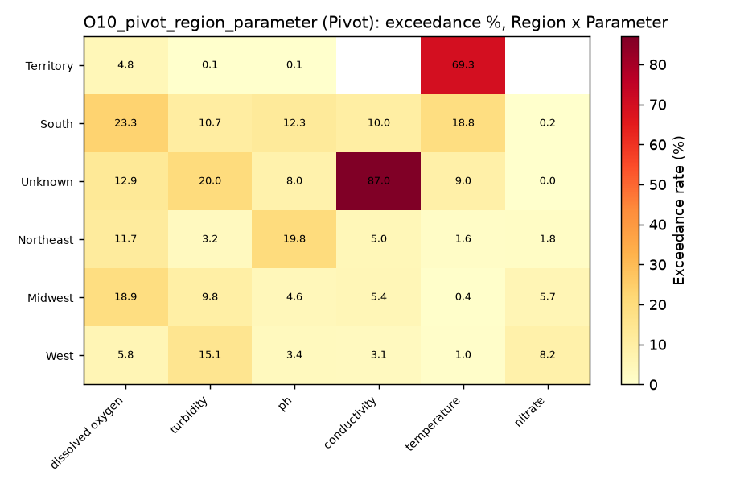

- **Interpretation:** _[TO FILL after local run: 2–3 sentences. What is the largest / smallest value, how big is the gap, and what does it mean for monitoring?]_

---

## CUBE

**In simple words:** `GROUP BY CUBE(a, b, c)` computes the measure for **every combination** of the listed dimensions **and every subtotal**, including the grand total, in one query. With 3 dimensions that is 2³ = 8 groupings. Rows where a dimension is summed over show `ALL` (detected with `GROUPING()`).

**Analogy:** A full sales report that shows totals by product, by shop, by month, by every pair of those, and the overall total, all at once.

**Same thing in Power BI:** Matrix visual with row and column subtotals switched on.

### O11_cube_month_region_group

- **Business question:** Across Month x Region x ParameterGroup, what are the exceedance rates for every combination and every subtotal?
- **Dimensions:** Month (year_month) × Region × Parameter group, all 8 groupings
- **Measure:** results, exceedances, exceedance %, high-risk %, grouping_id
- **OLAP operation:** CUBE
- **SQL:**

```sql
-- CUBE(a, b, c) returns all 2^3 = 8 groupings in one pass: detail, every pair, every single dimension and the grand total.
-- GROUPING() returns 1 when the column is rolled up, so the label becomes 'ALL'.
SELECT CASE WHEN GROUPING(d.year_month) = 1 THEN 'ALL' ELSE d.year_month END          AS year_month,
       CASE WHEN GROUPING(l.region) = 1 THEN 'ALL' ELSE l.region END                  AS region,
       CASE WHEN GROUPING(c.parameter_group) = 1 THEN 'ALL' ELSE c.parameter_group END AS parameter_group,
       GROUPING(d.year_month, l.region, c.parameter_group)                            AS grouping_id,
       sum(m.sample_count)                                                            AS results,
       sum(m.exceedance_count)                                                        AS exceedances,
       round(100.0 * sum(m.exceedance_count) / sum(m.sample_count), 2)                AS exceedance_pct,
       round(100.0 * sum(m.high_risk_count)  / sum(m.sample_count), 2)                AS high_risk_pct
FROM dw.fact_site_monthly_water_quality m
JOIN dw.dim_date d ON d.date_key = m.month_date_key
JOIN dw.dim_monitoring_location l USING (location_key)
JOIN dw.dim_characteristic c USING (characteristic_key)
GROUP BY CUBE (d.year_month, l.region, c.parameter_group)
ORDER BY grouping_id, year_month, region, parameter_group;
```

- **Output:** `tables/O11_cube_month_region_group.csv`, chart `figures/O11_cube_month_region_group.png`. Rows: _[TO FILL after local run]_. Median time: _[TO FILL from tables/O00_query_times.csv]_ ms.

  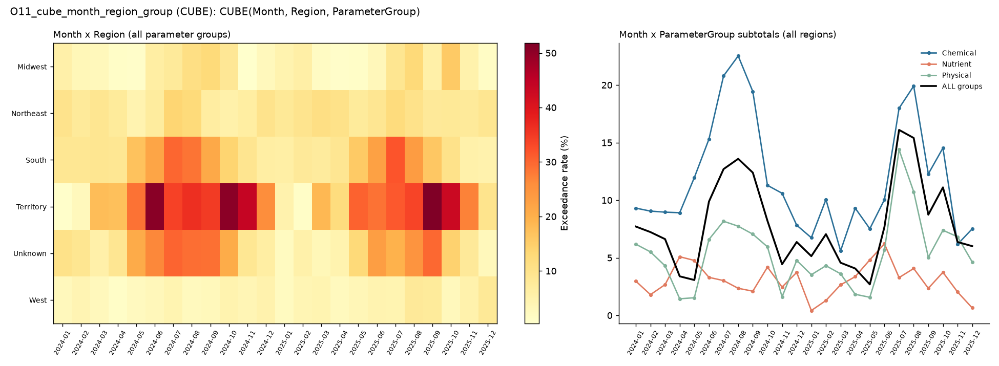

- **Interpretation:** _[TO FILL after local run: 2–3 sentences. What is the largest / smallest value, how big is the gap, and what does it mean for monitoring?]_

### O12_cube_season_group

- **Business question:** Across Season x ParameterGroup, including subtotals, when and where are high-risk results concentrated?
- **Dimensions:** Season × Parameter group, all 4 groupings
- **Measure:** results, exceedance %, high-risk %, high-risk results
- **OLAP operation:** CUBE
- **SQL:**

```sql
-- Smaller CUBE read from the detail fact. High-risk results are rare, so the rate keeps 3 decimals.
SELECT CASE WHEN GROUPING(d.season) = 1 THEN 'ALL' ELSE d.season END                  AS season,
       CASE WHEN GROUPING(c.parameter_group) = 1 THEN 'ALL' ELSE c.parameter_group END AS parameter_group,
       GROUPING(d.season, c.parameter_group)                                          AS grouping_id,
       count(*)                                                                       AS results,
       round(100.0 * avg(f.exceedance_flag), 2)                                       AS exceedance_pct,
       round(100.0 * avg(f.high_risk_flag), 3)                                        AS high_risk_pct,
       sum(f.high_risk_flag)                                                          AS high_risk_results
FROM dw.fact_water_quality_result f
JOIN dw.dim_date d USING (date_key)
JOIN dw.dim_characteristic c USING (characteristic_key)
GROUP BY CUBE (d.season, c.parameter_group)
ORDER BY grouping_id, season, parameter_group;
```

- **Output:** `tables/O12_cube_season_group.csv`, chart `figures/O12_cube_season_group.png`. Rows: _[TO FILL after local run]_. Median time: _[TO FILL from tables/O00_query_times.csv]_ ms.

  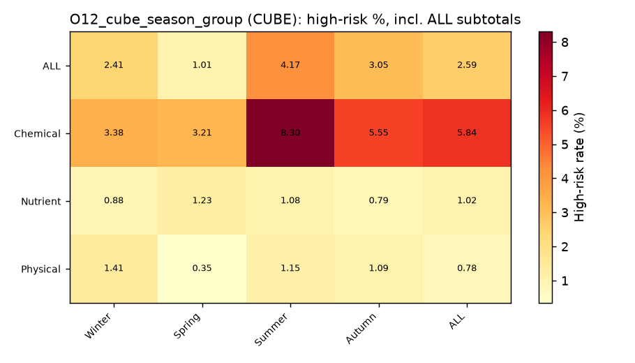

- **Interpretation:** _[TO FILL after local run: 2–3 sentences. What is the largest / smallest value, how big is the gap, and what does it mean for monitoring?]_

---

## GROUPING SETS

**In simple words:** Like CUBE, but **you choose exactly which groupings** you want. `GROUPING SETS ((region), (parameter), (season), ())` gives four separate summaries from one scan of the data.

**Analogy:** Asking the shop for three separate lists (by product, by shop, overall) and getting them stapled together in one report.

**Same thing in Power BI:** Several small visuals / cards on one page, each grouped by a different field.

### O13_grouping_sets_summary

- **Business question:** In one scan, what are the exceedance rates by region, by parameter, by season and overall?
- **Dimensions:** Region | Characteristic | Season | Overall (4 grouping sets)
- **Measure:** results, sites, exceedance %, high-risk %
- **OLAP operation:** GROUPING SETS
- **SQL:**

```sql
-- GROUPING SETS lists exactly the groupings wanted (here 4), instead of all combinations as CUBE does.
SELECT CASE WHEN GROUPING(l.region) = 0 THEN 'Region'
            WHEN GROUPING(c.short_name) = 0 THEN 'Parameter'
            WHEN GROUPING(d.season) = 0 THEN 'Season'
            ELSE 'Overall' END                                        AS dimension,
       coalesce(l.region, c.short_name, d.season, 'ALL')              AS member,
       count(*)                                                       AS results,
       count(DISTINCT f.location_key)                                 AS sites,
       round(100.0 * avg(f.exceedance_flag), 2)                       AS exceedance_pct,
       round(100.0 * avg(f.high_risk_flag), 2)                        AS high_risk_pct
FROM dw.fact_water_quality_result f
JOIN dw.dim_date d USING (date_key)
JOIN dw.dim_monitoring_location l USING (location_key)
JOIN dw.dim_characteristic c USING (characteristic_key)
GROUP BY GROUPING SETS ((l.region), (c.short_name), (d.season), ())
ORDER BY dimension, exceedance_pct DESC;
```

- **Output:** `tables/O13_grouping_sets_summary.csv`, chart `figures/O13_grouping_sets_summary.png`. Rows: _[TO FILL after local run]_. Median time: _[TO FILL from tables/O00_query_times.csv]_ ms.

  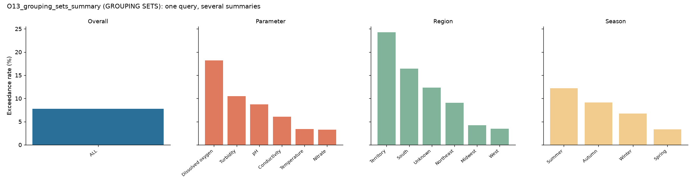

- **Interpretation:** _[TO FILL after local run: 2–3 sentences. What is the largest / smallest value, how big is the gap, and what does it mean for monitoring?]_

### O14_grouping_sets_org_method

- **Business question:** Does the exceedance rate depend on the data provider, the sample type or the equipment used?
- **Dimensions:** Provider | Sample type | Equipment (3 grouping sets of the organisation/method dimension)
- **Measure:** results, organisations, exceedance %, high-risk %
- **OLAP operation:** GROUPING SETS
- **SQL:**

```sql
-- GROUPING SETS on the organisation/method (junk) dimension: three separate one-dimension summaries in one query.
SELECT CASE WHEN GROUPING(o.provider) = 0 THEN 'Provider'
            WHEN GROUPING(o.sample_type_group) = 0 THEN 'Sample type'
            ELSE 'Equipment' END                                      AS dimension,
       coalesce(o.provider, o.sample_type_group, o.equipment_group, 'Not recorded') AS member,
       count(*)                                                       AS results,
       count(DISTINCT o.organization)                                 AS organizations,
       round(100.0 * avg(f.exceedance_flag), 2)                       AS exceedance_pct,
       round(100.0 * avg(f.high_risk_flag), 2)                        AS high_risk_pct
FROM dw.fact_water_quality_result f
JOIN dw.dim_organization_method o USING (org_method_key)
GROUP BY GROUPING SETS ((o.provider), (o.sample_type_group), (o.equipment_group))
ORDER BY dimension, results DESC;
```

- **Output:** `tables/O14_grouping_sets_org_method.csv`, chart `figures/O14_grouping_sets_org_method.png`. Rows: _[TO FILL after local run]_. Median time: _[TO FILL from tables/O00_query_times.csv]_ ms.

  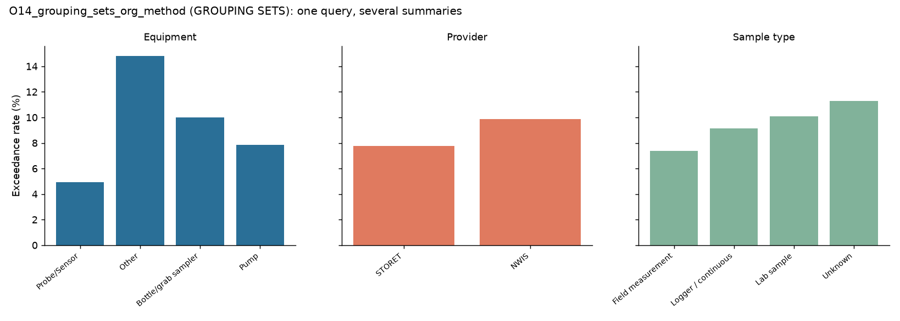

- **Interpretation:** _[TO FILL after local run: 2–3 sentences. What is the largest / smallest value, how big is the gap, and what does it mean for monitoring?]_

---

## ROLLUP

**In simple words:** `GROUP BY ROLLUP(a, b, c)` follows a **hierarchy** from left to right: detail rows, then subtotals for (a, b), then (a), then the grand total. It is the SQL form of roll-up along one hierarchy. It gives fewer rows than CUBE because it only makes "parent" subtotals.

**Analogy:** A bank statement with a line per day, a subtotal per month, a subtotal per year and a grand total at the end.

**Same thing in Power BI:** Matrix visual with the hierarchy on rows and "Row subtotals" on.

### O15_rollup_time_hierarchy

- **Business question:** What are the results and exceedance rate per month, with quarter, year and grand-total subtotals?
- **Dimensions:** Time hierarchy Year → Quarter → Month
- **Measure:** results, sites, exceedance %, with subtotal level label
- **OLAP operation:** ROLLUP
- **SQL:**

```sql
-- ROLLUP(year, quarter, month) follows the Time hierarchy: month rows, quarter subtotals, year subtotals, grand total.
SELECT CASE WHEN GROUPING(d.year) = 1 THEN 'ALL' ELSE d.year::text END        AS year,
       CASE WHEN GROUPING(d.quarter) = 1 THEN 'ALL' ELSE 'Q' || d.quarter END  AS quarter,
       CASE WHEN GROUPING(d.month) = 1 THEN 'ALL' ELSE lpad(d.month::text, 2, '0') END AS month,
       CASE WHEN GROUPING(d.year) = 1 THEN 'Grand total'
            WHEN GROUPING(d.quarter) = 1 THEN 'Year subtotal'
            WHEN GROUPING(d.month) = 1 THEN 'Quarter subtotal'
            ELSE 'Month' END                                                  AS level,
       sum(m.sample_count)                                                    AS results,
       count(DISTINCT m.location_key)                                         AS sites,
       round(100.0 * sum(m.exceedance_count) / sum(m.sample_count), 2)        AS exceedance_pct
FROM dw.fact_site_monthly_water_quality m
JOIN dw.dim_date d ON d.date_key = m.month_date_key
GROUP BY ROLLUP (d.year, d.quarter, d.month)
ORDER BY d.year NULLS LAST, d.quarter NULLS LAST, d.month NULLS LAST;
```

- **Output:** `tables/O15_rollup_time_hierarchy.csv`, chart `figures/O15_rollup_time_hierarchy.png`. Rows: _[TO FILL after local run]_. Median time: _[TO FILL from tables/O00_query_times.csv]_ ms.

  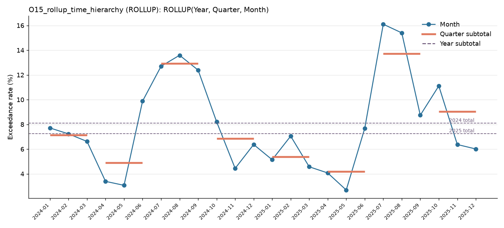

- **Interpretation:** _[TO FILL after local run: 2–3 sentences. What is the largest / smallest value, how big is the gap, and what does it mean for monitoring?]_

### O16_rollup_parameter_hierarchy

- **Business question:** Per characteristic, with parameter-group subtotals and a grand total, how often are thresholds exceeded?
- **Dimensions:** Parameter hierarchy Parameter group → Characteristic
- **Measure:** results, sites, exceedances, exceedance %, high-risk %
- **OLAP operation:** ROLLUP
- **SQL:**

```sql
-- ROLLUP(parameter_group, characteristic) follows the Parameter hierarchy.
SELECT CASE WHEN GROUPING(c.parameter_group) = 1 THEN 'ALL' ELSE c.parameter_group END AS parameter_group,
       CASE WHEN GROUPING(c.short_name) = 1 THEN 'ALL' ELSE c.short_name END          AS characteristic,
       CASE WHEN GROUPING(c.parameter_group) = 1 THEN 'Grand total'
            WHEN GROUPING(c.short_name) = 1 THEN 'Group subtotal'
            ELSE 'Characteristic' END                                                 AS level,
       sum(m.sample_count)                                                            AS results,
       count(DISTINCT m.location_key)                                                 AS sites,
       sum(m.exceedance_count)                                                        AS exceedances,
       round(100.0 * sum(m.exceedance_count) / sum(m.sample_count), 2)                AS exceedance_pct,
       round(100.0 * sum(m.high_risk_count)  / sum(m.sample_count), 2)                AS high_risk_pct
FROM dw.fact_site_monthly_water_quality m
JOIN dw.dim_characteristic c USING (characteristic_key)
GROUP BY ROLLUP (c.parameter_group, c.short_name)
ORDER BY c.parameter_group NULLS LAST, c.short_name NULLS LAST;
```

- **Output:** `tables/O16_rollup_parameter_hierarchy.csv`, chart `figures/O16_rollup_parameter_hierarchy.png`. Rows: _[TO FILL after local run]_. Median time: _[TO FILL from tables/O00_query_times.csv]_ ms.

  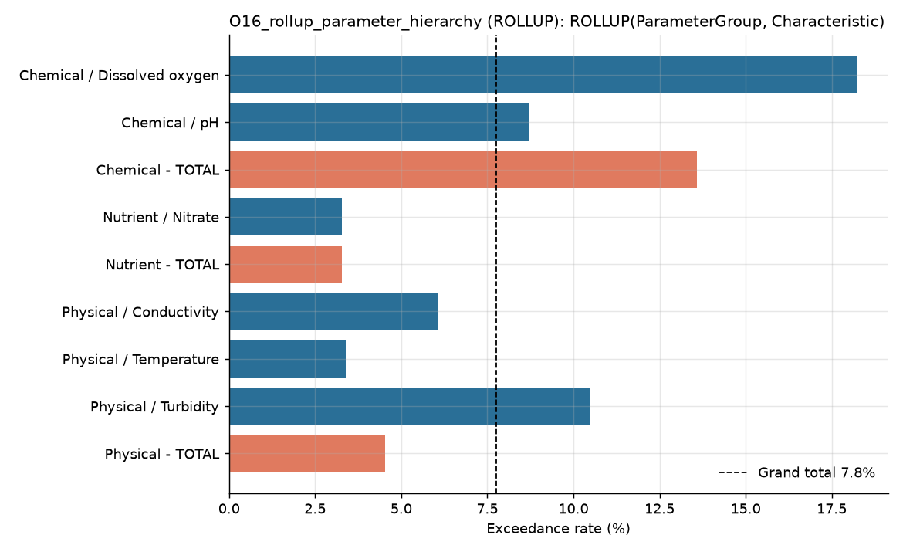

- **Interpretation:** _[TO FILL after local run: 2–3 sentences. What is the largest / smallest value, how big is the gap, and what does it mean for monitoring?]_
---

## DAX equivalents (Power BI)

The same operations in the Power BI model (see `POWERBI_BUILD_GUIDE.md` for the measures):

| Operation | DAX / Power BI |
|---|---|
| Roll-Up | `SUMMARIZECOLUMNS(dim_location[region], "Exceedance %", [Exceedance Rate %])` |
| Drill-Down | `SUMMARIZECOLUMNS(dim_date[year], dim_date[quarter], dim_date[month], "Exceedance %", [Exceedance Rate %])` |
| Slice | `CALCULATE([Exceedance Rate %], dim_characteristic[short_name] = "Dissolved oxygen")` |
| Dice | `CALCULATE([Exceedance Rate %], dim_location[region] IN {"South","West"}, dim_date[season] IN {"Summer","Winter"}, dim_characteristic[parameter_group] = "Chemical")` |
| Pivot | Matrix visual, `season` on Columns |
| CUBE / ROLLUP | Matrix with row + column subtotals; in DAX `ROLLUPADDISSUBTOTAL` inside `SUMMARIZECOLUMNS` |
| GROUPING SETS | Several `SUMMARIZECOLUMNS` tables combined with `UNION` |

Example (CUBE-like table in DAX query view):
```
EVALUATE
SUMMARIZECOLUMNS(
    ROLLUPADDISSUBTOTAL(dim_date[year_month], "Month total"),
    ROLLUPADDISSUBTOTAL(dim_location[region], "Region total"),
    ROLLUPADDISSUBTOTAL(dim_characteristic[parameter_group], "Group total"),
    "Results", [Results],
    "Exceedance %", [Exceedance Rate %]
)
```
